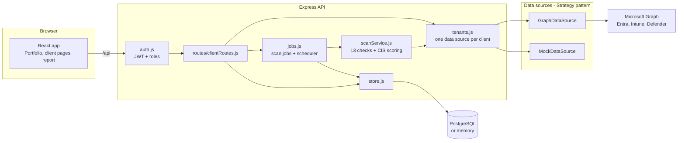

# Architecture

## Overview

## Key design decisions

**Strategy pattern for data sources.** `SecurityDataSource` defines every read (users, devices, sign-ins, alerts, and so on) and every action (disable account, device actions, alert updates). `GraphDataSource` talks to Microsoft Graph; `MockDataSource` serves a generated tenant. Routes and the scan engine never know which one they're using, so the demo exercises the same code as production.

**One data source per client.** `TenantRegistry` builds a data source for each managed tenant. In live mode each client has its own app registration in `clients.json`.

**Scans are jobs.** `ScanJobs` runs the 13 checks in order, publishes progress after each one, and saves the result. The frontend polls `/api/jobs/:id`. A scheduler rescans every client every `SCAN_INTERVAL_HOURS`.

**Checks fail independently.** If a tenant lacks a license or permission, that check is marked as an error and the rest of the scan continues. CIS safeguards without data are scored "No data" and excluded from the percentage.

**Detections are computed, not just read.** Impossible travel (great-circle distance over elapsed time above 900 km/h) and password spray (one IP failing against five or more accounts) are calculated from raw sign-ins, so they work even where Microsoft's own detections need higher licenses.

**Every action is accountable.** Actions require the Admin or Analyst role and a written reason. Wipe also requires typing the device name. Each step, including every playbook step, is written to the activity log with its result.

## Data model

| Table | Purpose | Key columns |
| --- | --- | --- |
| `users` | Northwatch staff accounts | email, password_hash (bcrypt), role |
| `scans` | One completed scan of one tenant | client_id, ran_at, score, compliance, open_gaps, high_gaps, result (JSONB) |
| `actions` | Audit trail of every tenant change | client_id, performed_by, action, target_type, target_id, reason, result, playbook |

## Security model

- Passwords hashed with bcrypt; sessions are 8-hour JWTs.
- Roles: Admin (everything, including team), Analyst (read and act), Viewer (read only). The first account becomes Admin. The last Admin can't be demoted.
- Microsoft Graph uses app-only tokens with least-privilege application permissions (see README).
- Secrets live in `.env` and `clients.json`, both git-ignored.
- CSV exports neutralize spreadsheet formulas to prevent CSV injection.

## Scan checks

| Area | Check | Graph source |
| --- | --- | --- |
| Posture | Secure Score | `/security/secureScores` |
| Identity | MFA registration | `/reports/authenticationMethods/userRegistrationDetails` |
| Identity | Global Admins | `/directoryRoles` |
| Identity | MFA enforcement | `/identity/conditionalAccess/policies`, security defaults |
| Identity | Legacy authentication | Conditional Access + sign-in client apps |
| Identity | Inactive accounts | `/users` with `signInActivity` |
| Identity | Risky users | `/identityProtection/riskyUsers` |
| Threats | Suspicious sign-ins | `/auditLogs/signIns` |
| Threats | Open alerts | `/security/alerts_v2` |
| Devices | Device compliance | `/deviceManagement/managedDevices` |
| Devices | Operating systems | `/deviceManagement/managedDevices` |
| Email | Phishing resilience | `/security/attackSimulation/simulations` |
| Cost | License hygiene | `/subscribedSkus` |
